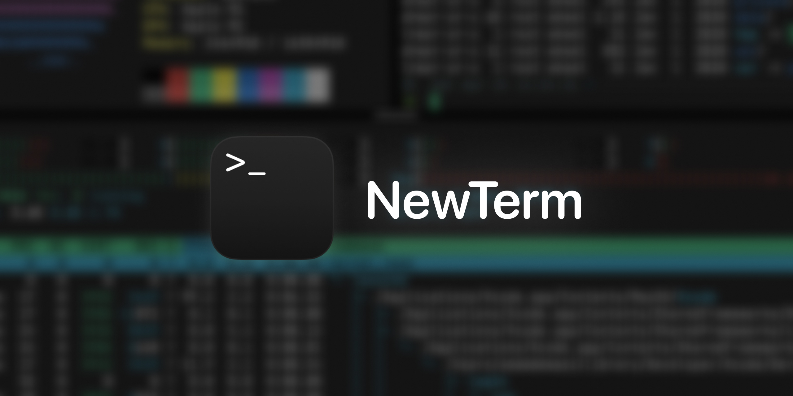

# NewTerm 3 for rootless iOS 15



NewTerm is a terminal emulator with tabs on iPhone and split panes on iPad. This repository packages the NewTerm 3 beta for **rootless iOS 15**, starting at **15.1.1**. Revision 7 was tested on an iPhone X running iOS 15.6.1.

## Install

Download the `iphoneos-arm64.deb` from the latest release, open it in your jailbreak package manager, and install it. If NewTerm is already running, finish your shell sessions before closing and reopening the app. [Download NewTerm](https://github.com/davghz/NewTerm/releases/latest)

To install revision 7 from a shell, run this in the directory containing the downloaded package and its matching `.sha256` file.

```sh
deb=ws.hbang.newterm3_3.0.beta1+ios15.1.1-7_iphoneos-arm64.deb
sha256sum -c "$deb.sha256" && sudo apt install "./$deb"
```

## Use the keyboard and tabs

- Tap the iOS keyboard microphone to dictate at the terminal cursor.
- Tap **Shift** to modify the next key. **Ctrl**, **Esc**, and the arrow keys are also on the main toolbar.
- Tap **More** to reach **Tab**, **Paste**, and the navigation keys. In OpenCode, **Paste** inserts text or attaches a clipboard image to your prompt. Tap **Fn** in the expanded row to show the function keys.
- Swipe down on the toolbar with one finger to dismiss the keyboard. Tap the terminal to bring it back.
- Tap **+** to open a tab. With iTerm2 shell integration enabled, a new tab can start in the current working directory. [iTerm2 shell integration](https://chariz.com/get/iterm2-shell-integration)

Terminal apps that enable mouse reporting receive taps on the corresponding text cell. In OpenCode, tap the **+** beside the session title to start a conversation. NewTerm’s **+** in the app toolbar opens a separate shell. Tap a shell tab’s title to select it or its close icon to end it.

## Run Codex or OpenCode

Install the corresponding CLI package, then type `codex` or `opencode` at the NewTerm prompt. [Codex for iOS](https://github.com/davghz/ios-codex) · [OpenCode for iOS](https://github.com/davghz/opencode-ios)

## Build the package

The release workflow uses Xcode 16.4 on macOS. With Xcode selected, run these commands from the repository root.

```sh
brew install ldid dpkg
.github/scripts/package-rootless.sh
```

The script writes the arm64 Debian package and its SHA-256 checksum to `packages/`. [Build workflow](.github/workflows/build.yml)

## Credits and license

NewTerm was developed by HASHBANG Productions. The project license and notices for earlier code, bundled fonts, and other assets are in the license file. [Upstream NewTerm](https://github.com/hbang/NewTerm) · [License and notices](LICENSE.md)
